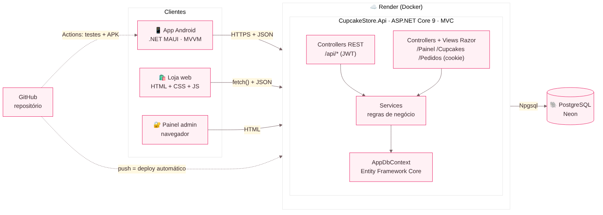

# 🧁 Cupcake Store

Sistema de pedidos para uma confeitaria de cupcakes: **app Android**, **loja web** e **painel administrativo**, todos ligados à mesma **API em ASP.NET Core (MVC)** com banco **PostgreSQL**.

Projeto Integrador Transdisciplinar de Engenharia de Software. O PI I foi o protótipo do app (.NET MAUI); o PI II, este repositório, é o sistema completo, testado e publicado.



## Navegue pelo projeto

| Pasta | Conteúdo |
|---|---|
| [`situacao-1/`](situacao-1) | **Planejamento revisado:** escopo, requisitos, UML, banco (SQL, DER, dicionário) e IHC |
| [`situacao-2/`](situacao-2) | **Desenvolvimento:** arquitetura MVC, endpoints, como rodar, deploy e manual |
| [`situacao-3/`](situacao-3) | **Testes e validação:** plano de testes, formulário, laudos, correções e vídeo |
| [`CupcakeStore.Api/`](CupcakeStore.Api) | Back-end: API REST, painel (Razor) e loja (HTML, CSS e JS) |
| [`CupcakeStore.Tests/`](CupcakeStore.Tests) | 70 testes automatizados (xUnit) |
| [`CardapioCupCake/`](CardapioCupCake) | App .NET MAUI (MVVM) |
| [`.github/workflows/`](.github/workflows) | CI: testes a cada push e geração do APK |

## Funcionalidades

**Cliente (app e loja web):** criar conta · entrar · ver cardápio e detalhes · carrinho com quantidades · finalizar pedido com endereço · acompanhar status · cancelar pedido recém-feito · editar perfil.

**Administrador (painel):** indicadores (faturamento, pedidos do dia, por status, mais vendidos) · gerenciar pedidos e avançar o status · gerenciar o cardápio (novo, editar, desativar).

## Tecnologias

| Camada | Tecnologia |
|---|---|
| Back-end | C# · ASP.NET Core 9 · padrão MVC · Entity Framework Core |
| Banco | PostgreSQL (Neon em produção; banco em memória para desenvolvimento e testes) |
| Segurança | Senhas com hash PBKDF2 · JWT na API · cookie no painel · antiforgery nos formulários |
| Front-end web | Razor (painel) · HTML, CSS e JavaScript puro (loja) |
| Mobile | .NET MAUI · MVVM · CommunityToolkit |
| Testes | xUnit · WebApplicationFactory · Playwright (roteiro da loja) |
| DevOps | GitHub Actions · Docker · Render |

## Rodar em 1 minuto

```bash
dotnet run --project CupcakeStore.Api
# abra http://localhost:5080  (loja em /loja/, painel em /Painel)
# admin: admin@cupcakestore.com / Admin@12345
dotnet test CupcakeStore.Tests
```

Detalhes, PostgreSQL, app e deploy: [situacao-2/README.md](situacao-2/README.md).

## Uso de inteligência artificial

Este projeto usou o assistente de IA **Claude (Anthropic)** como apoio para gerar o código da API e dos testes, a integração do app, os scripts SQL, os diagramas UML (Mermaid e Graphviz) e a documentação. O autor revisou, executou, testou e ajustou todo o material. Os testes com usuários foram feitos por pessoas reais, conforme os laudos em `situacao-3/laudos`.

## 🤝 Equipe

- **Pedro Henrique Paitax**: PI II (API, painel, loja web, testes, integração do app e documentação)

<<<<<<< HEAD
### Colaboradores do PI I

<table>
  <tr>
    <td align="center">
      <a href="#">
        <br>
        <sub>
          <b>Isabelle Galvão</b>
        </sub>
      </a>
    </td>
  </tr>
</table>
=======
## 🚀 Instalação e execução

### 1. Clone o repositório

git clone <url-do-repositorio>


Instalação e execução
---------------------
1. Clone o repositório:
   git clone <url-do-repositorio>

2. Abra a solução no __Visual Studio 2022__:
   - Abra o arquivo .sln
   - Selecione a plataforma alvo (Android / iOS / Windows) na __Solution Configuration__ / __Solution Platforms__
   - Use __Rebuild Solution__ se desejar limpar o build anterior

3. Execute:
   - Clique em __Start__ ou use __Debug > Start Debugging__ para executar no emulador/dispositivo selecionado.

Rodando via CLI (alternativa)
-----------------------------
- Restaurar pacotes:
  dotnet restore

- Build:
  dotnet build

- Executar (exemplo Android):
  dotnet build -f net9.0-android
  (ou use as diretivas específicas do projeto / IDE conforme necessário)

Estrutura do projeto
--------------------
- CardapioCupCake.Core.Models — modelos (ex.: CupcakeModel)
- CardapioCupCake.Core.Service — serviços e repositórios (ex.: ListCupCakeRepository)
- CardapioCupCake.Core.ViewModel — ViewModels para cada View
- CardapioCupCake.Core.View — páginas XAML (.xaml / .xaml.cs)
- Resources / Styles — cores e estilos compartilhados
