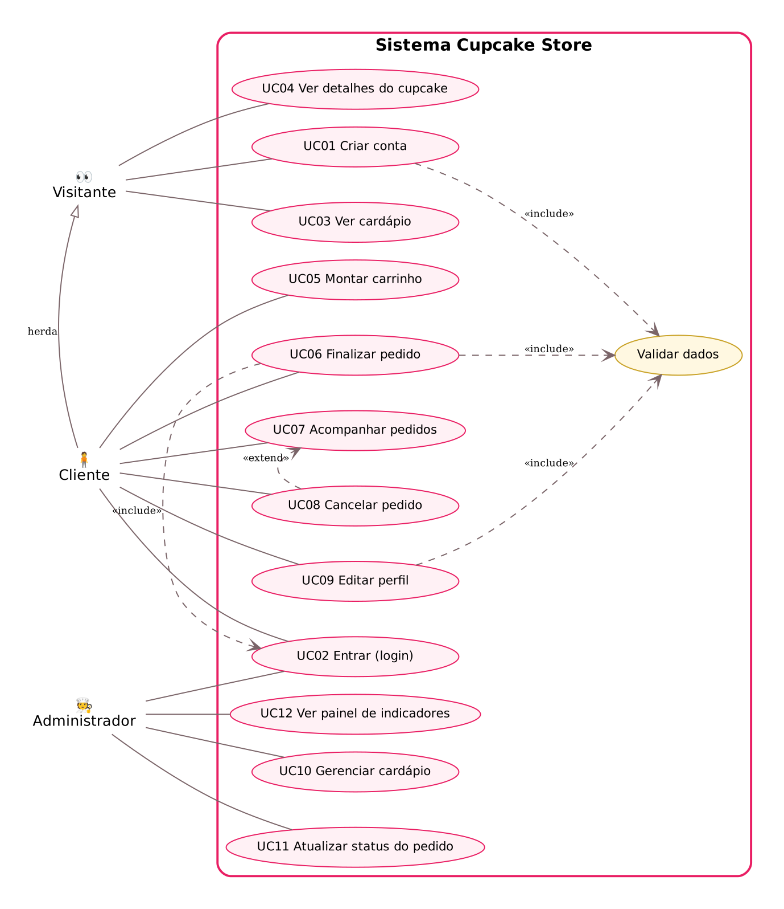
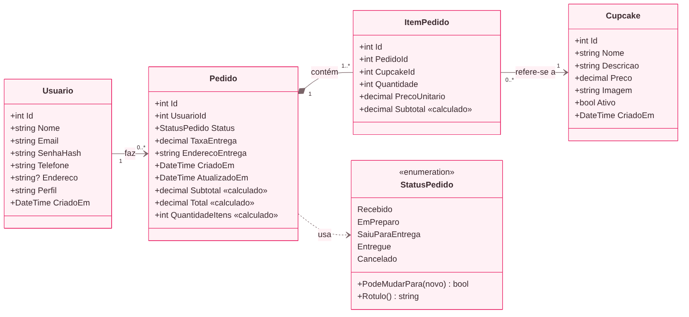
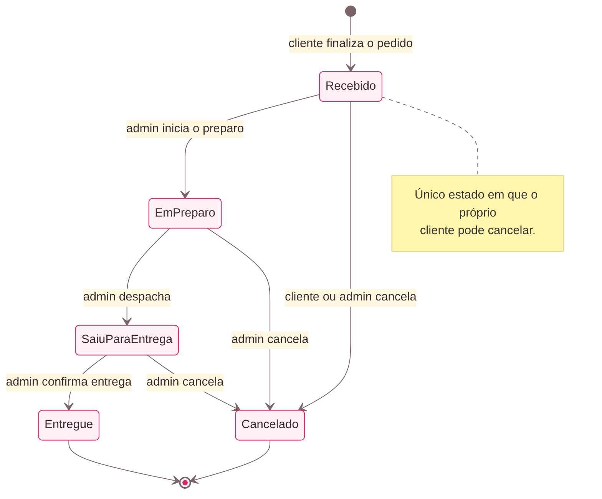
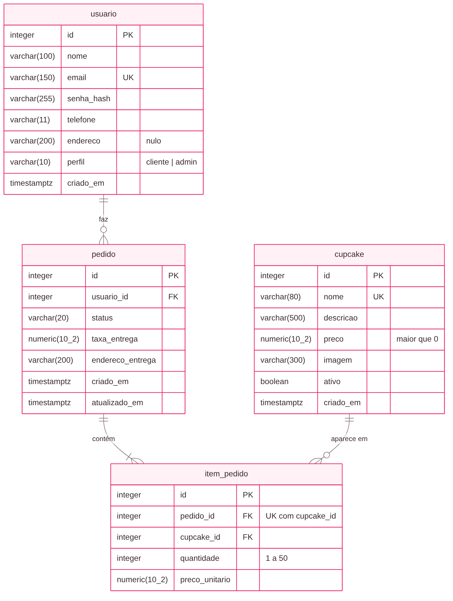

# Situação 1: planejamento revisado

O PI I entregou um app MAUI só com telas: os dados ficavam numa lista fixa, o login aceitava apenas `admin@teste.com`, o carrinho vinha de dados falsos e "Finalizar pedido" mostrava só um alerta. Esta revisão transforma o protótipo num sistema de verdade, com servidor, banco de dados e regras de negócio.

## 1. Escopo revisado

**Problema.** Uma confeitaria pequena recebe pedidos por mensagem e anota à mão. Ela perde pedidos, erra totais e não sabe o que vende mais.

**Solução.** O Cupcake Store tem três frentes que compartilham a mesma API e o mesmo banco:

| Frente | Para quem | Tecnologia |
|---|---|---|
| App Android | Cliente | .NET MAUI (MVVM), já existente no PI I |
| Loja web | Cliente sem Android ou que prefere o navegador | HTML, CSS e JavaScript puro |
| Painel administrativo | Dono(a) da confeitaria | ASP.NET Core MVC (views Razor) |

**Fora do escopo** (para caber no prazo): pagamento online, cálculo de frete por distância, notificações push e recuperação de senha por e-mail.

### O que mudou em relação ao PI I

| Item | PI I | Revisão (PI II) |
|---|---|---|
| Dados | Lista fixa no código | PostgreSQL com 4 tabelas normalizadas |
| Login | Usuário e senha fixos no código | API com senha em hash (PBKDF2) e token JWT |
| Cadastro | Simulado (`resultado = true`) | Gravado no banco, com e-mail único |
| Carrinho | Dados falsos (`mockOrderItems`) | Carrinho real compartilhado entre as telas |
| Finalizar pedido | Só um alerta | Pedido gravado, com preço do servidor |
| Acompanhar pedido | Não existia | Tela "Meus pedidos" com o status |
| Administração | Não existia | Painel web com cardápio, pedidos e indicadores |
| Testes | Nenhum | 70 testes automatizados (xUnit) |

## 2. Requisitos

### Funcionais

| ID | Requisito | Caso de uso |
|---|---|---|
| RF01 | Cadastrar cliente com nome, e-mail, telefone, endereço e senha | UC01 |
| RF02 | Autenticar com e-mail e senha | UC02 |
| RF03 | Listar os cupcakes ativos com foto, descrição e preço | UC03, UC04 |
| RF04 | Adicionar ao carrinho, alterar quantidades e remover itens | UC05 |
| RF05 | Finalizar o pedido informando o endereço de entrega | UC06 |
| RF06 | Mostrar o histórico de pedidos com o status atual | UC07 |
| RF07 | Permitir ao cliente cancelar um pedido que ainda não entrou em preparo | UC08 |
| RF08 | Editar os dados do perfil | UC09 |
| RF09 | Incluir, editar, desativar e reativar cupcakes (admin) | UC10 |
| RF10 | Avançar o status do pedido ou cancelá-lo (admin) | UC11 |
| RF11 | Exibir faturamento, pedidos do dia, pedidos por status e mais vendidos (admin) | UC12 |

### Não funcionais

| ID | Requisito |
|---|---|
| RNF01 | Senhas guardadas apenas como hash; nunca em texto puro |
| RNF02 | A API exige token JWT para pedidos e perfil, e o painel exige login de administrador |
| RNF03 | Mensagens de erro em português, sem detalhes técnicos para o usuário |
| RNF04 | Loja web utilizável em celular (390 px) sem rolagem lateral |
| RNF05 | Banco em PostgreSQL, um SGBD popular e de fácil manutenção |
| RNF06 | Código versionado no GitHub, com testes rodando a cada push (GitHub Actions) |
| RNF07 | Padrão MVC no back-end e MVVM no app |

### Regras de negócio

| ID | Regra |
|---|---|
| RN01 | O e-mail é único (sem diferenciar maiúsculas e minúsculas) |
| RN02 | A senha tem no mínimo 8 caracteres; o telefone tem DDD e 10 ou 11 dígitos |
| RN03 | O preço do pedido é sempre o do servidor; o valor enviado pelo app é ignorado |
| RN04 | O preço fica congelado no pedido: um reajuste no cardápio não muda pedidos antigos |
| RN05 | A quantidade vai de 1 a 50 por cupcake; itens repetidos são somados numa linha só |
| RN06 | A taxa de entrega é fixa (R$ 5,00, configurável) |
| RN07 | Fluxo do status: Recebido → Em preparo → Saiu para entrega → Entregue. Dá para cancelar antes de entregar |
| RN08 | O cliente só cancela pedidos com status "Recebido" |
| RN09 | Cupcake já vendido não é apagado, só desativado (preserva o histórico) |
| RN10 | O cliente só vê os próprios pedidos |

## 3. Modelagem UML

Os diagramas estão em [`uml/`](uml), com o código-fonte (`.mmd` e `.dot`) e a imagem (`.png`).

| Diagrama | Arquivo |
|---|---|
| Casos de uso | [casos-de-uso.png](uml/casos-de-uso.png) |
| Classes de domínio (persistência) | [classes.png](uml/classes.png) |
| Classes da arquitetura MVC | [classes-arquitetura.png](uml/classes-arquitetura.png) |
| Sequência: login | [sequencia-login.png](uml/sequencia-login.png) |
| Sequência: finalizar pedido | [sequencia-finalizar-pedido.png](uml/sequencia-finalizar-pedido.png) |
| Atividades: jornada do pedido | [atividades-pedido.png](uml/atividades-pedido.png) |
| Estados do pedido | [estados-pedido.png](uml/estados-pedido.png) |
| Arquitetura e implantação | [arquitetura.png](uml/arquitetura.png) |

## 4. Banco de dados

| Etapa | Entrega |
|---|---|
| Projeto conceitual | Diagrama de classes de persistência ([classes.png](uml/classes.png)) |
| Projeto lógico normalizado (3FN) | DER ([der.png](uml/der.png)) e a seção de normalização do dicionário |
| Projeto físico | [`banco/01-schema.sql`](banco/01-schema.sql) |
| Dados iniciais | [`banco/02-dados-iniciais.sql`](banco/02-dados-iniciais.sql) |
| Consultas do painel | [`banco/03-consultas-uteis.sql`](banco/03-consultas-uteis.sql) |
| Teste das restrições | [`banco/04-teste-restricoes.sql`](banco/04-teste-restricoes.sql), com a [saída real](banco/04-teste-restricoes.resultado.txt) |
| Dicionário de dados | [`banco/dicionario-de-dados.md`](banco/dicionario-de-dados.md), gerado do catálogo do PostgreSQL |

> No Mermaid, `numeric(10_2)` é a forma de escrever `numeric(10,2)`, porque a vírgula não é permitida no diagrama.

## 5. IHC

Veja [`ihc/README.md`](ihc/README.md): mapa de navegação, catálogo de mensagens de erro, heurísticas de Nielsen aplicadas e a revisão das telas do protótipo.

## 6. Crítica dos colegas

Esta etapa pede que a revisão passe por colegas. Os pedidos de crítica são publicados no fórum da disciplina; preencha a tabela abaixo com o que voltar.

| Colega | Sugestão recebida | Aceita? | O que foi feito |
|---|---|---|---|
| | | | |
| | | | |
| | | | |
