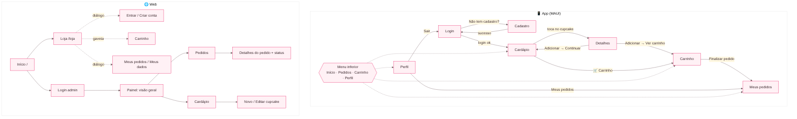

# IHC: interface e mensagens

## Mapa de navegação

## Revisão das telas do protótipo (PI I → PI II)

| Tela | Problema no PI I | Ajuste |
|---|---|---|
| Login | Aceitava só um usuário fixo | Autentica na API e mostra a mensagem do servidor |
| Cadastro | Não gravava nada; a validação de e-mail estava desligada | Grava na API; valida e-mail, telefone e senha antes de enviar |
| Cardápio | Nome "Fulano de Tal" fixo; lista fixa | Mostra o primeiro nome do usuário; carrega da API; puxar para atualizar; botão do carrinho com contador |
| Detalhes | O botão "Adicionar ao carrinho" não estava ligado a nenhum comando; o total não atualizava | Botão funcionando; o total acompanha a quantidade; oferece "Ver carrinho" ou "Continuar comprando" |
| Carrinho | Itens falsos; total sempre R$ 0,00; o botão "Mudar" não fazia nada | Itens reais com + e −; subtotal, taxa e total corretos; "Mudar" edita o endereço; estado vazio ilustrado |
| Perfil | Não tinha botão de salvar; a validação tratava a senha como CPF | Botões Salvar, Meus pedidos e Sair; validação corrigida |
| Meus pedidos | Não existia | Lista com status colorido, itens, total e cancelamento |
| Menu inferior | "Busca" sem ação; "Pedidos" abria o carrinho | Início, Pedidos, Carrinho e Perfil, todos funcionando; não empilha telas repetidas |

As telas da loja web e do painel estão em [`../../situacao-3/evidencias`](../../situacao-3/evidencias).

## Catálogo de mensagens

Todas as mensagens vêm da API (camada de serviço) ou da validação local da tela, sempre em português e sem termos técnicos.

| Situação | Mensagem | Onde aparece |
|---|---|---|
| Campos obrigatórios vazios | "Preencha todos os campos obrigatórios!" | Cadastro (app e web) |
| E-mail mal formatado | "O formato do e-mail é inválido." | Cadastro e perfil |
| E-mail já cadastrado | "Este e-mail já está em uso." | Cadastro e perfil |
| Telefone inválido | "Telefone inválido. Use DDD + número (10 ou 11 dígitos)." | Cadastro e perfil |
| Senha curta | "A senha deve ter no mínimo 8 caracteres." | Cadastro |
| Senhas diferentes | "As senhas digitadas não são iguais. Por favor, verifique." | Cadastro |
| Login errado | "E-mail ou senha inválidos." (não diz qual dos dois, por segurança) | Login |
| Carrinho vazio | "O carrinho está vazio." | Finalizar pedido |
| Sem endereço | "Informe o endereço de entrega." | Finalizar pedido |
| Cupcake desativado | "Cupcake X não está mais disponível." | Finalizar pedido |
| Quantidade acima do limite | "A quantidade máxima por cupcake é 50." | Finalizar pedido |
| Cancelamento tardio | "Só é possível cancelar pedidos que ainda não entraram em preparo." | Meus pedidos |
| Token expirado | "Sua sessão expirou. Faça login novamente." | Qualquer tela logada |
| Sem internet | "Não foi possível conectar ao servidor. Verifique sua internet." | App |
| Servidor lento (Render acordando) | "O servidor demorou para responder. Tente novamente em alguns segundos." | App |
| Mudança de status inválida | "Não é possível mudar de \"Recebido\" para \"Entregue\"." | Painel |
| Página inexistente | "Página não encontrada" (página ilustrada) | Painel e site |

## Heurísticas de Nielsen aplicadas

| Heurística | Como aparece no sistema |
|---|---|
| Visibilidade do status | Indicador de carregamento em login, cardápio e pedido; barra de progresso do pedido na loja; contador do carrinho |
| Correspondência com o mundo real | Status em linguagem de confeitaria ("Em preparo", "Saiu para entrega"); valores em R$ |
| Controle e liberdade | Cancelar pedido recém-feito; "Continuar comprando" depois de adicionar; botão Voltar no cadastro |
| Consistência | Mesma paleta (coral, pêssego e rosa) no app, na loja e no painel; mesmos nomes de status em todo lugar |
| Prevenção de erros | Quantidade limitada entre 1 e 50; confirmação antes de cancelar ou desativar; e-mail validado antes de enviar |
| Reconhecer em vez de lembrar | O endereço do cadastro já vem preenchido no pedido; o carrinho fica salvo na loja web |
| Eficiência | Busca instantânea no cardápio; filtros por status no painel |
| Design minimalista | Cada tela tem uma ação principal destacada |
| Ajudar a reconhecer erros | Mensagens dizem o que fazer ("Use DDD + número") |
| Ajuda | Dicas nos campos (placeholder) e textos de estado vazio ("Você ainda não fez pedidos") |
