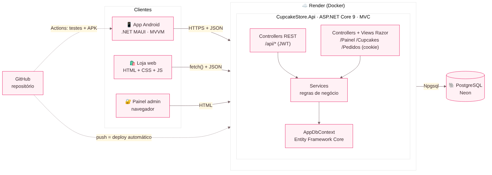

# Situação 2: desenvolvimento

## O que foi construído

| Projeto | Pasta | Papel |
|---|---|---|
| **CupcakeStore.Api** | [`/CupcakeStore.Api`](../CupcakeStore.Api) | Back-end ASP.NET Core 9 em **MVC**: API REST, painel administrativo (Razor) e loja web (HTML, CSS e JS) |
| **CupcakeStore.Tests** | [`/CupcakeStore.Tests`](../CupcakeStore.Tests) | 70 testes xUnit: unidade (regras de negócio) e integração (API completa em memória) |
| **CardapioCupCake** | [`/CardapioCupCake`](../CardapioCupCake) | App .NET MAUI do PI I (MVVM), agora ligado à API |



## Como o MVC está organizado

| Camada | Onde | Responsabilidade |
|---|---|---|
| **Model** | `Models/Entidades.cs`, `Models/Dtos.cs`, `Models/ViewModels.cs` | Entidades do banco, contratos JSON da API e modelos das telas do painel |
| **View** | `Views/**.cshtml` e `wwwroot/loja` | Painel em Razor e loja em HTML, CSS e JS puro |
| **Controller** | `Controllers/` (painel) e `Controllers/Api/` (REST) | Recebem a requisição, chamam o serviço e devolvem a View ou o JSON |
| Serviços | `Services/` | Regras de negócio (validação, preço, fluxo de status). Os controllers não acessam o banco direto |
| Dados | `Data/AppDbContext.cs` | Mapeamento objeto-relacional (Entity Framework Core + Npgsql) |

Os controllers são finos. Toda regra fica nos serviços, que devolvem um `Resultado<T>` (sucesso, ou erro com tipo e mensagem). Assim as regras são testadas sem precisar de HTTP, e a API converte o erro no status certo: 400, 401, 404 ou 409.

## Endpoints da API

| Método | Rota | Autenticação | Resposta |
|---|---|---|---|
| POST | `/api/usuarios` | — | 201 com o usuário · 400 dados inválidos · 409 e-mail em uso |
| POST | `/api/login` | — | 200 `{ token, usuario }` · 401 credenciais inválidas |
| GET | `/api/usuarios/me` | JWT | 200 com o usuário |
| PUT | `/api/usuarios/me` | JWT | 200 · 400 · 409 |
| GET | `/api/cupcakes` | — | 200 com o cardápio (só os ativos) |
| GET | `/api/cupcakes/{id}` | — | 200 · 404 |
| POST | `/api/pedidos` | JWT | 201 com o pedido · 400 regra violada |
| GET | `/api/pedidos/meus` | JWT | 200 com o histórico |
| GET | `/api/pedidos/{id}` | JWT | 200 · 404 (também para pedido de outro cliente) |
| POST | `/api/pedidos/{id}/cancelar` | JWT | 200 · 400 já em preparo |
| GET | `/health` | — | 200 `{ status, banco }` |

Os erros seguem o padrão **ProblemDetails** (RFC 7807): a mensagem para o usuário vem no campo `detail`. Exemplos prontos para executar estão em [`CupcakeStore.Api.http`](../CupcakeStore.Api/CupcakeStore.Api.http).

## Páginas web

| Endereço | O que é |
|---|---|
| `/` | Início, com atalhos para a loja e o painel |
| `/loja/` | Loja do cliente: cardápio, carrinho, conta e meus pedidos |
| `/Conta/Login` | Login do painel (somente administrador) |
| `/Painel` | Indicadores: faturamento, pedidos do dia, em aberto, por status, mais vendidos |
| `/Pedidos` | Lista com filtro por status → detalhes → avançar ou cancelar |
| `/Cupcakes` | Cardápio: novo, editar, desativar e reativar, com busca e prévia da foto |

**Administrador inicial:** `admin@cupcakestore.com` / `Admin@12345`. Troque em produção pela variável `Admin__Senha`.

## Rodando no seu computador

### API, painel e loja

1. Abra `CardapioCupCake.sln` no Visual Studio 2022. O projeto `CupcakeStore.Api` já está na solução.
2. Clique com o botão direito em **CupcakeStore.Api** → *Definir como projeto de inicialização* → **F5**.
3. O navegador abre em `http://localhost:5080`.

Sem configurar nada, a API usa um **banco em memória** (aparece um aviso no log), o que é ótimo para testar rápido. Para usar o PostgreSQL, preencha `ConnectionStrings:Default` em `appsettings.Development.json`:

```json
"ConnectionStrings": {
  "Default": "Host=localhost;Port=5432;Database=cupcakestore;Username=postgres;Password=sua_senha"
}
```

As tabelas são criadas sozinhas na primeira execução. Se preferir criar à mão, rode `situacao-1/banco/01-schema.sql`.

Pelo terminal: `dotnet run --project CupcakeStore.Api`

### Testes

```bash
dotnet test CupcakeStore.Tests
```

No Visual Studio: menu **Teste → Executar todos os testes**. A cada push, o GitHub Actions roda os mesmos testes (aba *Actions* → "API - build e testes").

### App

1. Com a API rodando, selecione o emulador Android e rode o projeto **CardapioCupCake**.
2. Em Debug, o app chama `http://10.0.2.2:5080`, que é o seu PC visto pelo emulador.
3. Em Release (APK dos testadores), chama a URL do Render definida em [`ApiConfig.cs`](../CardapioCupCake/Core/Service/ApiConfig.cs).

## Publicando de graça (para os testadores usarem pelo link)

### 1. Banco no Neon
1. Crie uma conta em neon.tech → *New project*.
2. Copie a **connection string** (começa com `postgresql://`).

### 2. API no Render
1. Crie uma conta em render.com e ligue ao GitHub.
2. *New +* → **Blueprint** → escolha este repositório. O arquivo `render.yaml` já configura tudo.
3. Preencha `DATABASE_URL` com a connection string do Neon e `Admin__Senha` com uma senha forte.
4. O site fica em algo como `https://cupcake-store.onrender.com`.
5. Coloque essa URL em `ApiConfig.UrlProducao`, no app.

> O plano gratuito do Render "dorme" depois de 15 minutos sem uso. O primeiro acesso leva cerca de 50 s, e o app já espera até 70 s.

### 3. APK
1. Crie uma tag: `git tag v1.0.0 && git push --tags`.
2. O workflow **"App - gerar APK Android"** compila e anexa o `CupcakeStore.apk` a uma Release no GitHub.
3. Para gerar sem tag: aba *Actions* → o workflow → *Run workflow* → baixe em *Artifacts*.

## Manual rápido do usuário

**Cliente (app ou `/loja`):**
1. Crie a conta e entre.
2. Toque num cupcake, escolha a quantidade e adicione.
3. Abra o carrinho, confira os itens e o endereço e finalize.
4. Acompanhe em **Meus pedidos**. Dá para cancelar enquanto o status for "Recebido".

**Administrador (`/Painel`):**
1. Entre com o e-mail de administrador.
2. Em **Pedidos**, abra um pedido e avance o status (Em preparo → Saiu para entrega → Entregue).
3. Em **Cardápio**, cadastre um sabor novo ou desative um que acabou.

## Correções feitas no código do PI I

| Problema | Arquivo | Correção |
|---|---|---|
| `BaseViewModel` redeclarava `PropertyChanged`, então propriedades `[ObservableProperty]` (`IsBusy`, `TotalValue`) não atualizavam a tela | `BaseViewModel.cs` | Herda direto de `ObservableObject` |
| Botão "Adicionar ao carrinho" sem `Command` | `CupCakeDetalhesPage.xaml` | Ligado a `AddToCartCommand` |
| Cada tela criava o próprio repositório, então o carrinho nunca recebia os itens | `CupcakeDetailViewModel.cs` | `CarrinhoService` único |
| Carrinho ligado a `DisplayTotalPrice`, que não existia; `TotalPrice` sempre 0 | `CarrinhoViewModel.cs` | Totais calculados a partir dos itens |
| `hubService = hubService` e `listCupCakeRepository = listCupCakeRepository` (atribuição a si mesmo, ficava nulo) | `CadastroViewModel.cs`, `ProfileViewModel.cs` | Instâncias criadas corretamente |
| Perfil validava a **senha** como CPF, então "Salvar" sempre falhava | `ListCupCakeRepository .cs` | Validação de nome, e-mail, telefone e endereço |
| Telefone do perfil exigia máscara, mas o cadastro guardava só dígitos | `ListCupCakeRepository .cs` | Aceita 10 ou 11 dígitos com ou sem máscara |
| `Task.Delay(2000)` sem `await` e cadastro sempre "com sucesso" | `CadastroViewModel.cs` | Chamada real à API, com `await` |
| `HttpClient` novo a cada uso, com URL fictícia `minhaapi.com` | `HubService.cs` | `HttpClient` único, URL configurável, tratamento de erro e timeout |
| Arquivo com acentos em Windows-1252 (caracteres quebrados) | `CarrinhoPage.xaml.cs` | Regravado em UTF-8 |
| Menu "Pedidos" abria o carrinho e empilhava telas iguais | `MenuComp.xaml(.cs)` | Itens corretos e sem duplicar telas |

> O arquivo `ListCupCakeRepository .cs` tem um espaço antes do `.cs`. Vale renomear para `ListCupCakeRepository.cs` pelo Visual Studio (o conteúdo não muda).
